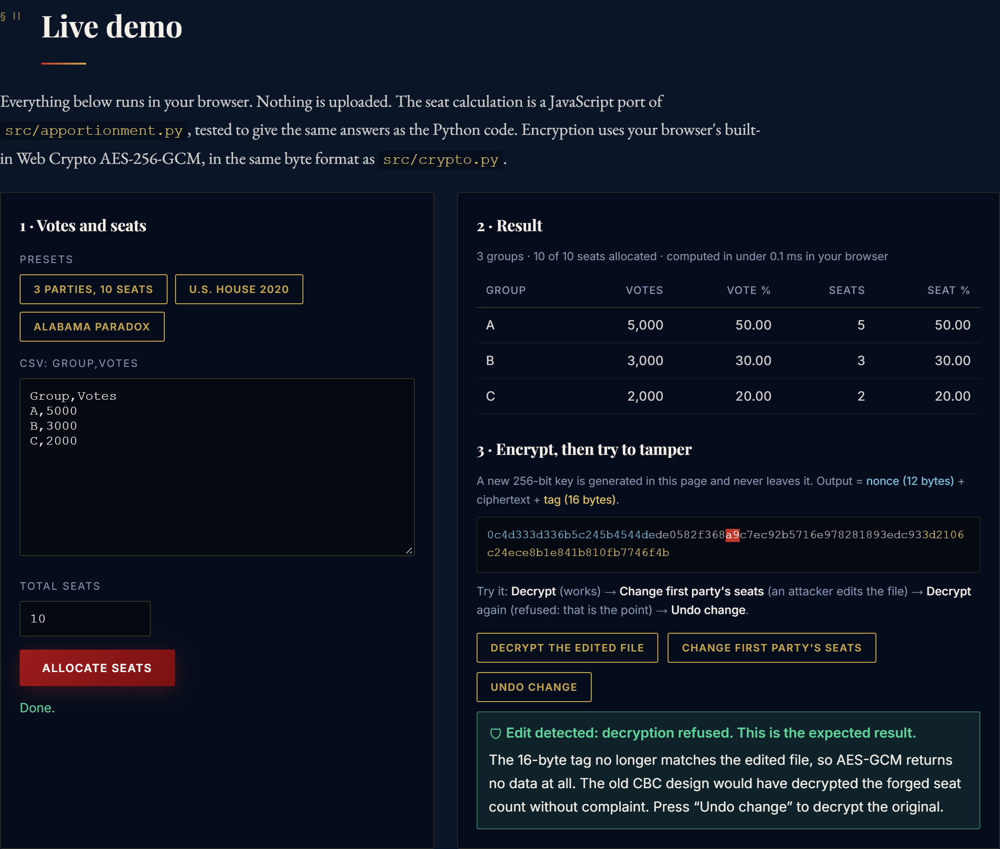

# Secure Apportionment System


**Splits parliament seats with the Huntington-Hill method and seals the results with authenticated encryption (AES-256-GCM).**

🔗 **Live demo:** https://secure-apportionment-system.pages.dev/#demo



*The demo runs in your browser. It allocates seats, encrypts the result, and lets you change one byte of the encrypted file. Decryption is then refused.*

---

## Why this exists

- **Problem.** Splitting seats fairly is a math problem: votes divide into fractions, but seats are whole. Storing the result safely is a security problem: hiding the numbers is not enough, you must also notice if someone edits them.
- **What it is.** A Huntington-Hill seat allocator (the method the U.S. House of Representatives has used since 1941), with a command-line tool, a Flask web app and encrypted output.
- **The hard part.** A security audit of the first encryption design (AES-256-CBC) found it didn't detect tampering. Without the key, the audit changed a party's seat count in a real results file from 2 to 8, and it still decrypted without error. So the project moved to authenticated encryption (AES-256-GCM), with tests proving that edit, and every other single-byte change, is now rejected.
- **Proof.** The [live demo](https://secure-apportionment-system.pages.dev/#demo), [403 automated tests](#tests-and-benchmark) that run on every push, and a [benchmark](#tests-and-benchmark).
- **How it was made.** Directed by Alborz Nazari and built with an AI coding assistant ([Claude Code](https://claude.com/claude-code)). The reasoning behind every part is written up in [DESIGN_DECISIONS.md](docs/DESIGN_DECISIONS.md).

---

## Quick start

Requires Python 3.10 or newer. Run every command from the project folder.

```bash
git clone https://github.com/AlborzNazari/Secure-Apportionment-System.git
cd Secure-Apportionment-System
python -m venv venv
```

Activate the virtual environment:

```bash
venv\Scripts\activate        # Windows
source venv/bin/activate     # macOS / Linux
```

Install and run:

```bash
pip install -r requirements.txt
python -m src.main sample_basic.csv --seats 100
```

Expected output:

```
Apportionment Results:
{'Party_A': 39, 'Party_B': 28, 'Party_C': 20, 'Party_D': 13}
Encrypted results saved to results.json.enc
Key saved to key.bin (keep secure!)
```

**Web app** (local only, see [limits](#security-design-and-its-limits)):

```bash
python -m src.app
```

Then open http://127.0.0.1:5000.

**Your own data:** a CSV with a `Group,Votes` header and one `name,whole number` row per party. Twelve example files (`sample_*.csv`) are included.

---

## How it works

1. Every party with at least one vote gets 1 seat.
2. Each party gets a priority score: `votes / √(n × (n + 1))`, where `n` is the seats it holds now.
3. The next seat goes to the highest score. That party's score drops. Repeat until all seats are given out.

The command-line tool then encrypts the result with AES-256-GCM and writes `results.json.enc`.

📖 **[docs/HOW_IT_WORKS.md](docs/HOW_IT_WORKS.md)** explains it in plain language: a pipeline diagram, a 3-party worked example, exactly how the encryption works, and a map from each feature to its file and function.

🧭 **[docs/DESIGN_DECISIONS.md](docs/DESIGN_DECISIONS.md)** explains *why*: why Huntington-Hill, why GCM replaced CBC, why the public demo runs in the browser, what each kind of test proves, and the known weaknesses.

---

## Security design and its limits

**What it does**

- AES-256-GCM via the Python [`cryptography`](https://cryptography.io) library (`src/crypto.py`).
- A fresh random 12-byte nonce for every encryption.
- A 16-byte authentication tag: a wrong key or any changed byte is rejected with `InvalidTag`.
- File format: nonce + ciphertext + tag.

**What it does not do (yet)**

- The command-line tool saves the key to `key.bin` next to the results. Anyone with both files can read them, or re-seal edited ones.
- The Flask web app does not encrypt anything.
- The web app has no login, no seat limit and does not escape party names. Run it only on your own machine.
- The tag proves the file was not changed. It does not prove who made it.

---

## Tests and benchmark

**403 automated tests** run on [GitHub Actions](.github/workflows/tests.yml) for every push (Python 3.10–3.13 and Node.js). 392 are Python tests and 11 are JavaScript tests. They check that:

- The result matches the official [2020 Census apportionment](https://www2.census.gov/programs-surveys/decennial/2020/data/apportionment/apportionment-2020-table01.xlsx) for all 50 states (`tests/data/us_house_2020.csv`).
- Seats always add up to the total.
- Adding a seat never removes one from any party (no Alabama paradox).
- AES-256-GCM rejects every tampered file in the tests.
- The JavaScript demo gives the same seats as the Python code.

Run them:

```bash
python -m pytest tests/
node --test tests/js/demo.test.mjs
```

**Benchmark** (`python scripts/benchmark.py`), Intel Core i9-12900K, Windows 11, Python 3.14.3, median of 7 repeats:

| Case | Time per call |
|---|---|
| U.S. House 2020 (50 states, 435 seats) | 122 µs |
| 12 parties, 650 seats | 168 µs |
| Same, every vote count ×1000 | 178 µs |
| 1,000 parties, 10,000 seats | 3.3 ms |
| 1,000 parties, 100,000 seats | 34 ms |
| AES-256-GCM encrypt, 785-byte result | 7 µs |

Time grows with the number of seats and parties, not with the number of votes. Your numbers will differ on other hardware.

---

## Roadmap

1. Keep the key out of the results folder: read it from an environment variable or the OS keyring.
2. Encrypt results in the web app, not only the command-line tool.
3. Harden the web app: cap the seat count, escape party names, turn off debug mode, use a production server.
4. Upgrade `cryptography` and Flask, and run a dependency audit in CI.
5. Sign results so readers can check who produced them.

---

## Project layout

```
src/apportionment.py   Huntington-Hill + CSV reader
src/crypto.py          AES-256-GCM encrypt / decrypt
src/main.py            command-line tool
src/app.py             Flask web app (templates/, static/)
public/index.html      project page + live demo (Cloudflare Pages)
scripts/benchmark.py   benchmark
tests/                 pytest suite, tests/js/ for the demo, tests/data/ fixtures
docs/HOW_IT_WORKS.md   plain-language guide (how)
docs/DESIGN_DECISIONS.md  why each part is built this way
```

`Dockerfile`, `docker-compose.yml` and `launcher.py` (a Windows desktop wrapper) are also included, but were not re-tested for this release. The `.exe` downloads on the Releases page predate the switch to AES-256-GCM.

## Troubleshooting

- **`ModuleNotFoundError: No module named 'src'`**: run commands from the project folder, not from inside `src/`.
- **`Apportionment Results: {}`**: every row was skipped. Check that each row is `name,whole number`, separated by a comma (not a semicolon), and that the file is saved as UTF-8.
- **PowerShell says running scripts is disabled** when you activate the virtual environment: run `Set-ExecutionPolicy -Scope Process Bypass` in that window, then activate again.

## More

- [Contributing](docs/CONTRIBUTING.md) · [Code of Conduct](docs/CODE_OF_CONDUCT.md)
- [Original write-up on Medium](https://medium.com/@alborznazari4/secure-apportionment-voting-system-v0-1-0-983054d369d5) (February 2026, describes v0.1.0 and the earlier CBC design)
