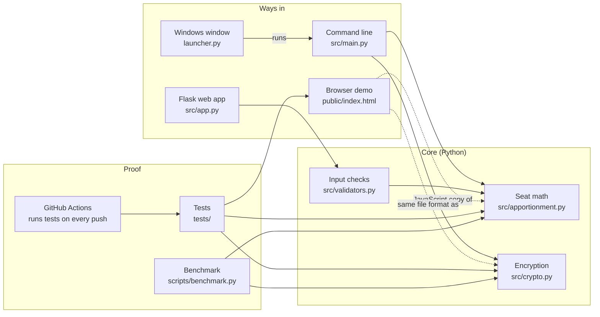

# Design Decisions

Why this project is built the way it is.
For *how* each piece works step by step, read [HOW_IT_WORKS.md](HOW_IT_WORKS.md) first. This page answers *why*.

Every section follows the same shape:
**What it is → Why it exists → Why this way → What it costs.**

---

## 1. The big picture

The project answers two questions:

1. **How many seats does each party get?** That is a math question.
2. **How do we keep the answer from being secretly changed?** That is a security question.

Everything else (the command-line tool, the web app, the demo, the tests) exists to answer those two questions, show the answers, or prove they are right.

**Key idea: one core, many doors.** The seat math lives in one Python function. Every way in calls it (or, for the browser, an exact tested copy of it). That way there is one thing to get right and one thing to test.

---

## 2. The seat math: `src/apportionment.py`

### What it is
The function `huntington_hill(shares, total_seats)`. It takes vote totals and a seat count, and returns seats per party.

### Why Huntington-Hill
- **It has a real-world track record.** The U.S. House of Representatives has used it since 1941. That gives us an official answer to test against (section 8).
- **It avoids the Alabama paradox.** With some methods, adding a seat to parliament can *take* a seat away from a party. Huntington-Hill never does that. It belongs to a family called **divisor methods**, which are all safe from this.
- **It is simple.** Under 40 lines of code, including comments.

### Why this way
- **Every party with votes starts with 1 seat.** That is the rule of the method. It also means a tiny party is never left with zero.
- **Priority score = votes ÷ √(n × (n+1)).** The square root of `n × (n+1)` is the **geometric mean** of `n` and `n+1`. It is what makes this method "Huntington-Hill" and not one of its cousins (Webster uses `n + 0.5`, Jefferson uses `n + 1`).
- **A heap picks the winner of each seat.** A **heap** is a structure that always hands back the biggest item quickly. Each seat costs about `log(parties)` steps instead of checking every party. Total work is roughly `(parties + seats) × log(parties)`.
- **Ties go to the name that sorts first.** Ties are rare, but a rule is needed so the result is always the same for the same input.

### What it costs
- **It can break "quota".** Occasionally a party gets more or fewer seats than its exact share rounded up or down. Every divisor method has this problem. A famous theorem (Balinski and Young, 1982) shows no method can avoid both this and the Alabama paradox.
- **It leans slightly toward small parties** compared with Webster's method.
- **It needs at least one seat per party with votes.** With 5 parties and 3 seats it refuses (raises `ValueError`).

---

## 3. Encryption: `src/crypto.py`

### What it is
Two functions: `encrypt_data(data, key)` and `decrypt_data(blob, key)`, using **AES-256-GCM**.

### Why encrypt at all
A results file on disk can be read or changed by anyone who can reach that disk. Encryption should give two guarantees:
- **Confidentiality**: outsiders cannot read the numbers.
- **Integrity**: outsiders cannot change the numbers without being noticed.

### Why GCM, and not CBC (the important story)
The first version used **AES-256-CBC**. CBC gives confidentiality only.

The audit found the weakness and proved it: with no key, editing the first 16 bytes of `results.json.enc` changed a party's seats from 2 to 8, and the file still decrypted without error. For an election result, that is the worst possible failure. A forged result looks real.

**GCM** (Galois/Counter Mode) is **authenticated encryption**. It hides the data *and* adds a 16-byte **tag**, a fingerprint of the key, nonce and data. Decryption recomputes the tag. If one bit changed anywhere, the tags differ and decryption returns nothing.

Ways the CBC problem could have been fixed:

| Option | Why not chosen |
|---|---|
| Keep CBC, add a separate HMAC (a keyed fingerprint) | Works, but means two keys and an ordering rule you can get wrong. Easy to make mistakes. |
| Keep CBC, check the padding | Padding checks are not integrity checks; they can even leak data ("padding oracle" attacks). |
| **AES-GCM** | One standard step does both jobs. Built into Python's `cryptography` library and every modern browser. **Chosen.** |
| ChaCha20-Poly1305 | Also excellent. GCM was chosen because browsers' Web Crypto supports it, which the live demo needs. |

### Why these details
- **256-bit key**: the strongest AES size. The cost is negligible here (7 µs per encryption).
- **12-byte random nonce per message**: the size GCM is designed for (NIST SP 800-38D). A **nonce** must never repeat with the same key. Random 12-byte nonces are safe for about 4 billion messages per key; this tool uses one key per run, so it is far from that limit.
- **File layout: nonce + ciphertext + tag**: everything needed to decrypt (except the key) is in one file. The browser demo uses the exact same layout. A test proves the browser can decrypt a file made by Python.
- **The `cryptography` library, not hand-written crypto**: it wraps OpenSSL, which is widely reviewed. Writing your own crypto is the classic security mistake.

### What it costs (known weaknesses)
- **The key is saved as `key.bin` next to the results.** That is like leaving the house key in the door. Anyone with both files can read the results, and can also *re-seal* edited ones, because the tag only proves "someone with the key made this". Fix: keep the key in an environment variable or the OS keyring (roadmap item 1).
- **The tag does not prove who made the file.** Proving authorship needs a **digital signature** (roadmap item 5).

---

## 4. The command-line tool: `src/main.py`

### What it is
`python -m src.main votes.csv --seats 100`. It reads the CSV, allocates seats, prints them, and writes `results.json.enc` and `key.bin`.

### Why it exists
It is the simplest complete path: input → math → encrypted file. It is also what the Windows `.exe` is built from.

### Why this way
- **Encrypt, then decrypt the votes in memory.** This step only demonstrates the round trip. It adds no security, because the key is right there. It is kept for teaching, and stated honestly in HOW_IT_WORKS.
- **A fresh key per run.** Simple and safe from nonce reuse, at the cost of a new `key.bin` every time.

### What it costs
- No input validation (the web app has some; see section 6).
- `key.bin` handling, as above.

---

## 5. The Flask web app: `src/app.py`, `templates/`, `static/`

### What it is
A local website (`python -m src.app`, then http://127.0.0.1:5000). Upload a CSV, see a table and charts, try 11 built-in scenarios.

### Why it exists
Most people understand seat allocation faster from a chart than from printed numbers. The scenarios show known effects (vote splitting, coalitions, the Alabama paradox) on real-looking data.

### Why Flask
It is the smallest well-known Python web framework. One file can serve a page and one upload endpoint.

### What it costs (be upfront about these)
- **It does not encrypt.** The page says so.
- **It is not safe on the internet.** It has no login and no cap on the seat count (a huge number makes the server loop for minutes). It also inserts party names into the page without escaping them, so a crafted CSV could run JavaScript. And `python -m src.app` starts in debug mode.
- That is why the public demo is **not** this app (section 7).

---

## 6. Input checks: `src/validators.py`

### What it is
`validate_csv_data()` rejects empty data, negative votes and a zero total. `validate_seats_allocation()` checks seats against parties and caps them at 1,000.

### Why it exists
Bad input should give a clear message, not a crash or a silly answer.

### What it costs
Only the web app calls `validate_csv_data()`, and nothing calls `validate_seats_allocation()` yet. Wiring both in is part of roadmap item 3.

---

## 7. The live demo: `public/index.html`

### What it is
The project page at https://secure-apportionment-system.pages.dev/, hosted on **Cloudflare Pages** (a service that serves static files). Its demo allocates seats and encrypts the result entirely in your browser. A button edits one byte of the encrypted file so you can watch decryption be refused.

### Why it exists
"Trust me, it works" is weak. A button that lets anyone attack the file and see it caught is strong proof of the project's main claim.

### Why in the browser, not the Flask app
- **Nothing to attack.** A static page has no server, so the web app's weaknesses (section 5) never reach the internet.
- **Free and fast.** Static hosting costs nothing and never sleeps.
- **Private.** Votes never leave the visitor's computer.

### Why this way
- **The math is a JavaScript copy of the Python function.** Browsers do not run Python. To make sure the copy is faithful, tests run both on the 2020 House data and on 300 random elections, and require identical answers.
- **Encryption uses the browser's built-in Web Crypto.** It is native, fast and audited. No crypto library is downloaded.
- **The key is "non-extractable".** The browser will not let page code read the key's bytes. It can only use the key.
- **The tamper button edits exactly the byte holding the first party's seat count.** GCM encrypts like a stream: byte *i* of the ciphertext lines up with byte *i* of the text. So an attacker who knows the layout can aim an edit precisely. That is the same attack that beat CBC. The demo shows the tag stopping it.
- **Party names are added as plain text**, never as HTML, so a name like `` cannot run code. A browser test checks this.

### What it costs
Two copies of the algorithm (Python and JavaScript) must stay in sync. The cross-language test is what keeps that safe.

---

## 8. Tests: `tests/`

### Why tests matter here
In both fields, "looks right" is not good enough. Seat math can be off by one seat in one state. Encryption can "work" (round-trips fine) while being forgeable, which is exactly what happened with CBC.

### What is tested, and why each kind

| Kind of test | Example | Why |
|---|---|---|
| **Known answer** | Reproduce the official 2020 House apportionment: 50 states, 435 seats | The strongest check there is: an official source computed it independently. The test also catches near-misses: Webster's method gets 4 states wrong and fails it. |
| **Properties** | Seats always sum to the total; adding a seat never removes one | Must hold for *every* input, so they run on hundreds of random elections. |
| **Attacks** | Wrong key; flipped bits; every single-byte edit; the exact CBC-style 2 → 8 edit; cut-off and padded files | A security claim is only as good as the attacks you tried. |
| **Cross-language** | JavaScript and Python agree on 300 random elections; browser decrypts a Python-made file | Keeps the demo honest. |
| **Docs honesty** | The test counts in the README and on the page match the real suites | Stops the documentation from drifting into false claims. |

### Continuous integration: `.github/workflows/tests.yml`
**CI** means GitHub runs every test automatically on every push. It runs them on four Python versions (3.10–3.13) plus Node.js, because a project that only works on one machine is not really working.

---

## 9. The benchmark: `scripts/benchmark.py`

### Why it exists
The old page claimed "200,000+ ballots per second". That number meant nothing: the algorithm never sees ballots, only one total per party. The benchmark replaces claims with measurements.

### What it shows
- The 2020 House takes about 122 µs (millionths of a second).
- Time depends on parties and seats, **not votes**: multiplying every vote count by 1,000 barely changes it.
- Numbers come with the machine, Python version and method (median of 7 runs), so anyone can repeat them.

---

## 10. Supporting pieces

| Piece | Why it exists | Status |
|---|---|---|
| `src/logging_setup.py` | Writes a timestamped log of each web request to `logs/`, for debugging and an audit trail | Works. It logs results in plain text, which undercuts encryption; worth fixing. |
| `launcher.py` | A simple Windows window for people who never use a terminal; it runs the packaged `.exe` | Not re-tested; the released `.exe` still uses the old CBC code. |
| `Dockerfile`, `docker-compose.yml` | Run the web app in a container: same setup on any machine, as a non-root user | Not re-tested in this release. |
| `sample_*.csv` | Twelve ready-made elections that show specific effects | Checked; false descriptions were corrected. |

---

## 11. Known weaknesses and the plan

Being upfront about weaknesses is part of the design. A security project that hides its limits is not trustworthy.

1. **Key next to data** → read the key from an environment variable or the OS keyring.
2. **Web app does not encrypt** → encrypt in `upload()` too.
3. **Web app not hardened** → cap seats, escape names, turn off debug, use a production server (for example gunicorn).
4. **Old dependencies** (`cryptography` 41.0.7 and Flask 3.0.0 have published advisories) → upgrade and add an automatic dependency audit to CI.
5. **No proof of authorship** → sign results with a digital signature.

---

## 12. Questions you should be able to answer

**Why not just round each party's exact share?**
The rounded numbers often do not add up to the seat total. Fixing that by hand (Hamilton's method) causes the Alabama paradox.

**Why is GCM better than CBC here?**
CBC hides data but cannot detect changes; the project proved a forged seat count would pass. GCM adds a tag that detects any change.

**If GCM stops tampering, why is `key.bin` still a problem?**
The tag proves "made by someone with the key". If the key sits next to the file, an attacker can edit the results and re-seal them with that key.

**What happens if a nonce repeats?**
With GCM, reusing a nonce with the same key can leak data and allow forgeries. That is why each encryption gets 12 fresh random bytes, and each run gets a new key.

**How do you know the algorithm is correct?**
It reproduces the official 2020 House apportionment exactly, and passes property tests on hundreds of random elections.

**How do you know the browser demo matches the Python code?**
A test feeds the same 300 random elections to both and requires identical results. Another makes the browser decrypt a Python-made file.

**Why is the public demo static instead of the Flask app?**
The Flask app has known weaknesses (no seat cap, no name escaping, debug mode). A static page has no server to attack, costs nothing, and keeps visitors' data on their own machine.

**What would you fix first?**
Key handling. Encryption is only as strong as where the key is kept.
