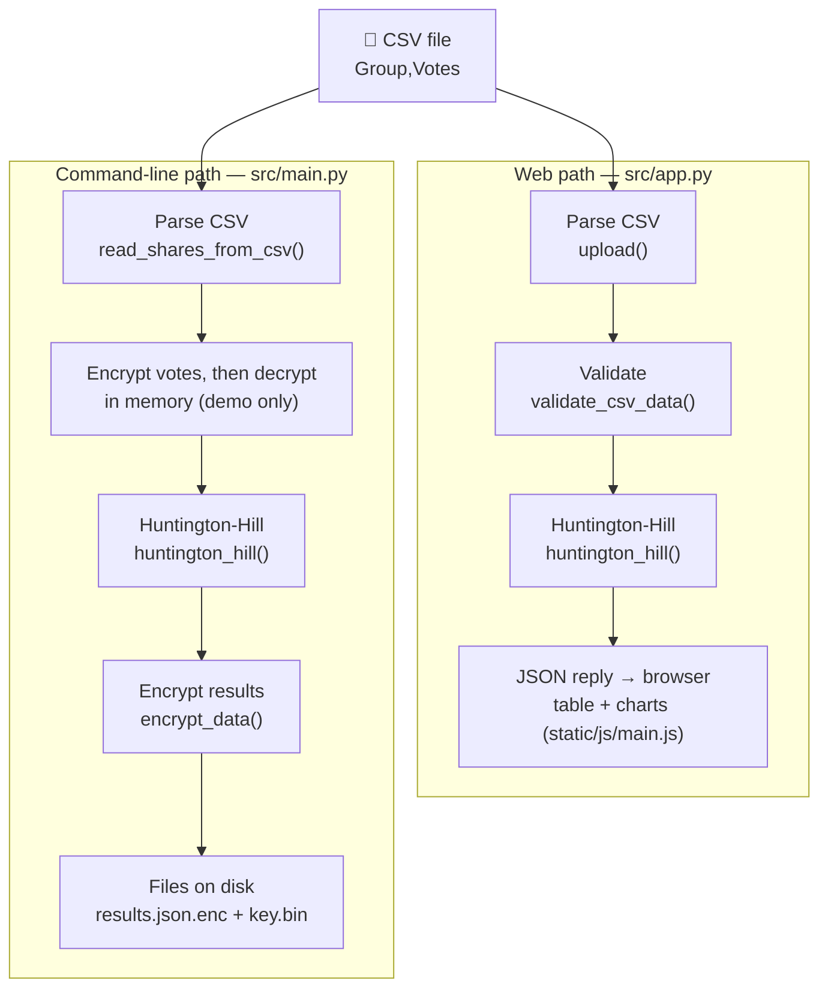

# How It Works

A plain-language tour of the Secure Apportionment System.
It describes what the code does today, not what the other docs promise.

---

## 1. What goes in, what comes out

You give the system two things.
The first is a **CSV file**. A CSV ("comma-separated values") file is a plain text table where commas separate the columns.
Each row holds a party name and its vote count, like `Party_A,390000`.
The second is a **seat count**. That is the total number of parliament seats to hand out.
The system splits those seats between the parties with the **Huntington-Hill method**. That is a rule for turning votes into whole seats as fairly as possible.
What you get back depends on how you run it.
The **web app** shows a table and charts in your browser.
The **command-line tool** prints the result and saves an encrypted copy to a file.
**Encryption** means scrambling data so that only someone with the secret **key** can read it.

---

## 2. The pipeline

Two things stand out in the diagram.
The web path validates but never encrypts.
The command-line path encrypts but never calls the validator.
Section 6 lists these and other gaps.

The desktop app (`launcher.py`) is a small window on top of the command-line path.
It runs a packaged copy of `main.py` called `ApportionmentSys.exe` and shows its output.

---

## 3. Huntington-Hill, step by step

### The terms

- **Apportionment**: splitting a fixed number of seats between groups.
- **Priority score**: a number that says how strongly a party "deserves" its next seat. Highest score wins the next seat.
- **Geometric mean** of two numbers: the square root of their product. For 2 and 3 it is √(2×3) = √6 ≈ 2.449.

### The rule

1. Every party with at least one vote gets 1 seat to start.
2. For each party, work out its priority score:

   **Priority = Votes ÷ √(n × (n + 1))**

   Here `n` is the number of seats the party holds right now.
   The bottom part is the geometric mean of `n` and `n + 1`.
3. Give the next seat to the party with the highest score.
4. That party now has one more seat, so its score drops. Recompute it.
5. Repeat until all seats are given out.

Dividing by a growing number means each extra seat gets harder to win.
Large parties still win more seats, but small parties are not squeezed out.

### Worked example: 3 parties, 10 seats

Votes: **A = 5,000**, **B = 3,000**, **C = 2,000**. Total = 10,000.

**Start.** Each party gets 1 seat. That uses 3 seats. 7 are left.

Useful divisors (rounded):

| Seats held (n) | √(n × (n+1)) |
|---|---|
| 1 | √2 ≈ 1.414 |
| 2 | √6 ≈ 2.449 |
| 3 | √12 ≈ 3.464 |
| 4 | √20 ≈ 4.472 |

**Round by round.** The winner of each seat is in bold.

| Seat # | A's score | B's score | C's score | Winner | Seats after (A/B/C) |
|---|---|---|---|---|---|
| 4 | **5000 ÷ 1.414 = 3,536** | 3000 ÷ 1.414 = 2,121 | 2000 ÷ 1.414 = 1,414 | A | 2 / 1 / 1 |
| 5 | 5000 ÷ 2.449 = 2,041 | **2,121** | 1,414 | B | 2 / 2 / 1 |
| 6 | **2,041** | 3000 ÷ 2.449 = 1,225 | 1,414 | A | 3 / 2 / 1 |
| 7 | **5000 ÷ 3.464 = 1,443** | 1,225 | 1,414 | A | 4 / 2 / 1 |
| 8 | 5000 ÷ 4.472 = 1,118 | 1,225 | **1,414** | C | 4 / 2 / 2 |
| 9 | 1,118 | **1,225** | 2000 ÷ 2.449 = 817 | B | 4 / 3 / 2 |
| 10 | **1,118** | 3000 ÷ 3.464 = 866 | 817 | A | 5 / 3 / 2 |

**Result: A = 5, B = 3, C = 2.**
That matches the vote shares of 50%, 30% and 20% exactly.
These numbers come from running `huntington_hill()` on this input.

### How the code does it

`huntington_hill()` in `src/apportionment.py` keeps the scores in a **heap**.
A heap is a structure that always hands you the biggest (or smallest) item quickly.
Python's `heapq` gives the smallest item, so the code stores scores as negative numbers.
After each seat it pushes the party back with its new score.

Details worth knowing:

- A party with 0 votes gets 0 seats.
- If there are fewer seats than parties with votes, it raises `ValueError`.
- On an exact tie, the party whose name sorts first alphabetically wins.

---

## 4. How encryption works here

### The terms

- **AES** (Advanced Encryption Standard): a widely trusted way to scramble data.
- **AES-256**: AES with a 256-bit key. That is 32 bytes.
- **Mode**: the rule for applying AES to data longer than one 16-byte block.
- **GCM** (Galois/Counter Mode): a mode that both hides the data and seals it. It is **authenticated encryption**: if anyone changes even one bit, decryption fails.
- **Nonce** ("number used once"): 12 random bytes that make each encryption different. It is not secret, but it must never repeat with the same key.
- **Tag**: a 16-byte seal that GCM computes from the key, nonce and data. Decryption recomputes it and refuses the data if it does not match.
- **Padding**: extra bytes to fill a block. GCM does not need any.
- **Ciphertext**: the scrambled output.

### Exactly what the code does

| Item | Value | Where |
|---|---|---|
| Algorithm | AES-256 | `AESGCM(key)` in `src/crypto.py` |
| Mode | GCM (authenticated) | `cryptography.hazmat.primitives.ciphers.aead.AESGCM` |
| Key size | 32 bytes | `KEY_SIZE` |
| Key source | Fresh random key on every run | `generate_key()` |
| Key storage | Written to `key.bin` in the current folder | `main()` in `src/main.py` |
| Nonce | Fresh 12 random bytes per encryption | `os.urandom(NONCE_SIZE)` |
| Padding | None (GCM does not need it) | |
| Tag | 16 bytes, at the end | added by `AESGCM.encrypt` |
| Output format | nonce (12) + ciphertext + tag (16) | `encrypt_data()` |
| Library | `cryptography` | `requirements.txt` |

`os.urandom` asks the operating system for random bytes that are safe for cryptography.

### The steps in `src/crypto.py`

**Encrypt** (`encrypt_data`):
1. Check the key is 32 bytes.
2. Make a random 12-byte nonce.
3. Encrypt with AES-256-GCM. This also produces the tag.
4. Return nonce + ciphertext + tag.

**Decrypt** (`decrypt_data`):
1. Check the key is 32 bytes and the input is long enough.
2. Take the first 12 bytes as the nonce.
3. Decrypt and check the tag. A wrong key or any changed byte raises `InvalidTag`.

**The whole command-line run (`src/main.py`):**
1. Read the CSV into a Python dictionary.
2. Make one new random key.
3. Turn the votes into JSON text, encrypt them, then decrypt them right away in memory. This is a demo; the encrypted votes are never saved.
4. Run Huntington-Hill on the decrypted votes.
5. Turn the results into JSON, encrypt them, and write `<output>.enc`. With the default `--output results.json`, the file is `results.json.enc`.
6. Write the raw key to `key.bin`.

To read the results later, you need both `results.json.enc` and `key.bin`.

### Why GCM and not CBC

Earlier versions used AES-256-CBC. CBC hides data but does not seal it.
Anyone could change a seat count in `results.json.enc` by editing the first 16 bytes, without knowing the key.
`tests/test_crypto.py::test_cbc_style_seat_rewrite_is_rejected` shows GCM refuses that same edit.

### What it does not do

- **The key sits next to the data.** `key.bin` is written in plain form beside the encrypted file. Anyone with both files can read, and re-seal, the results.
- **`ENCRYPTION_KEY` is not used.** `backend/config.py` reads it from the environment, but no code calls `get_encryption_key()`.
- **The Flask web app does not encrypt at all.** Its results panel says so and points to the command-line tool.

---

## 5. Feature map

| Feature | File | Function |
|---|---|---|
| Web home page | `src/app.py` | `index()` |
| Web CSV upload + seat calculation | `src/app.py` | `upload()` |
| System info endpoint (`/api/info`) | `src/app.py` | `info()` |
| Command-line entry point | `src/main.py` | `main()` |
| Read CSV from disk | `src/apportionment.py` | `read_shares_from_csv()` |
| Huntington-Hill allocation | `src/apportionment.py` | `huntington_hill()` |
| Check vote data | `src/validators.py` | `validate_csv_data()` |
| Check seats vs. parties | `src/validators.py` | `validate_seats_allocation()` |
| Make encryption key | `src/crypto.py` | `generate_key()` |
| Encrypt (AES-256-GCM) | `src/crypto.py` | `encrypt_data()` |
| Decrypt and check tag | `src/crypto.py` | `decrypt_data()` |
| Logging to `logs/` and console | `src/logging_setup.py` | `setup_logging()` |
| Settings and env key | `backend/config.py` | `Config.get_encryption_key()` |
| Built-in sample scenarios | `static/js/main.js` | `loadScenario()` |
| Send upload to server | `static/js/main.js` | `uploadForm` submit handler |
| Results table | `static/js/main.js` | `displayResults()` |
| Bar / doughnut / deviation charts | `static/js/main.js` | `renderChart()` |
| Download results as CSV | `static/js/main.js` | `downloadBtn` click handler |
| Desktop window (Windows) | `launcher.py` | `run_command()` |
| Validator tests | `tests/test_validators.py` | `test_*` |
| Encryption and tamper tests | `tests/test_crypto.py` | `test_*` |
| Huntington-Hill tests (2020 US House, seat sums) | `tests/test_apportionment.py` | `test_*` |
| Benchmark | `scripts/benchmark.py` | `main()` |
| In-browser demo (seats + GCM tamper check) | `public/index.html` | `ApportionCore.huntingtonHill()`, `ApportionCore.parseCsv()` |
| Demo tests | `tests/js/demo.test.mjs`, `tests/test_js_port.py` | `test(...)`, `test_js_port_matches_python_on_300_random_elections()` |

`public/index.html` is the project page served at https://secure-apportionment-system.pages.dev/. Its live demo runs in the browser: a JavaScript port of `huntington_hill()` (`ApportionCore.huntingtonHill()`) and the browser's Web Crypto AES-256-GCM. `index.html` is an identical copy, and a test keeps them the same.

---

## 6. Gaps found while reading

No code was changed. These are notes for later.

1. **Web path skips encryption.** `upload()` never calls an encrypt function. The UI now says so plainly.
2. **CLI path skips validation.** `main()` never calls `validate_csv_data()`.
3. **`validate_seats_allocation()` is never called** anywhere outside tests.
4. ~~`src/AES-256.py` cannot be imported~~ — removed; encryption now lives in `src/crypto.py`.
5. ~~`tests/test.py` never ran~~ — its name did not match pytest's `test_*.py` pattern. Renamed to `tests/test_crypto.py`.
6. **Fewer seats than parties crashes the web app** with a generic "Server error". The `ValueError` is caught by the catch-all handler.
7. **A non-number in the web CSV** also gives a generic "Server error". The CLI reader skips such rows silently instead.
8. **`docs/ ARCHITECTURE.md`** says the key is "never persisted to disk" and that every path validates and encrypts. The code does neither on every path. (The filename also starts with a space.)
9. **Older docs describe CBC.** `docs/ ARCHITECTURE.md`, `ENCRYPTION.md`, `THREAT_MODEL.md` and `ssdlc.md` carry an "Outdated" note at the top.
